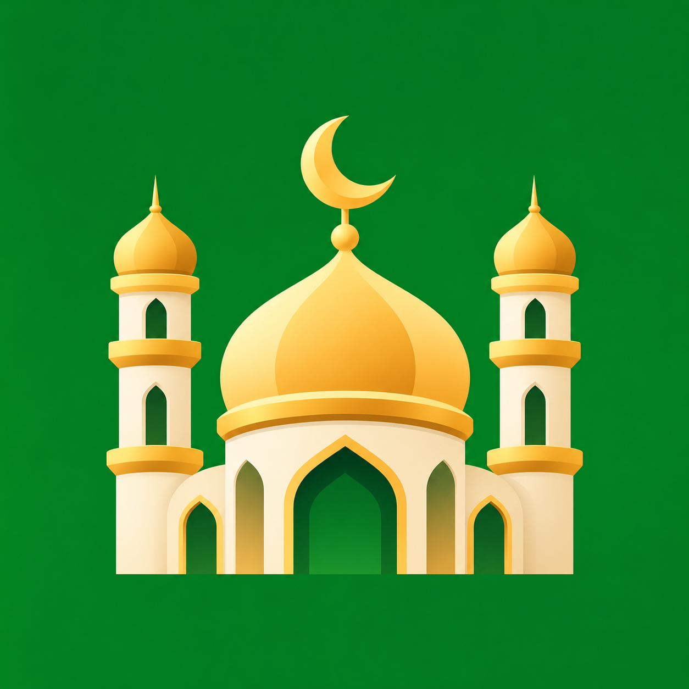

  

# 🌙 Nurra

### Your Daily Islamic Companion

A modern Islamic Android application designed to help Muslims stay connected with their daily worship through a simple, elegant, and intuitive experience.

---

# 🚧 COMING SOON

**Nurra is currently under development.**

Something meaningful is coming soon. Stay tuned!

---

## ✨ Planned Features

- 🕌 Prayer Times
- 📖 Al-Quran
- 🤲 Daily Duas & Dhikr
- 📿 Digital Tasbih
- 🧭 Qibla Direction
- 🎧 Quran Audio

## 🎨 Design & Technology

- Kotlin
- Jetpack Compose
- Material 3 Expressive
- Modern Android UI
- Offline-first experience

## 🚀 Project Status

**In Development**

Nurra is currently in its early development stage. Features, design, and functionality are subject to change.

## 📌 Stay Tuned

More updates will be shared as development progresses.

---

### Made with ❤️ for the Muslim community.

**Nurra — A little closer to Allah, every day.**
